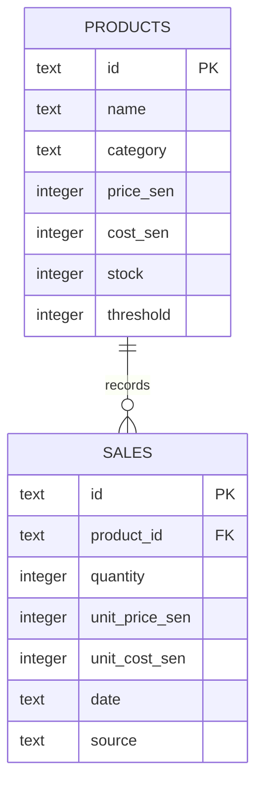

# Stockroom — Sales, inventory & analytics

A portfolio project for Sakib Ahmed combining a working café operations application with reproducible analysis. All starting data is synthetic.

## Features

- Product creation and editing, stock additions, configurable reorder levels.
- Atomic sales recording: a sales row and its inventory deduction commit together.
- CSV import with required columns, date/quantity validation, duplicate detection, and all-or-nothing writes.
- Revenue, gross profit, gross margin, product/category performance, and equal-length prior-period comparisons.
- Date-filtered CSV export and a companion Python notebook.
- Responsive interface with native keyboard-accessible dialog forms.

## Stack

React 19, TypeScript, Recharts, Vinext, Cloudflare Workers, D1 (SQLite), Drizzle migrations. Python/pandas for standalone analysis. This hosted implementation uses TypeScript and SQLite rather than the initially suggested Flask/PostgreSQL stack.

## Local setup

Requires Node 22.13+ (Node 24 recommended) and pnpm. The lockfile is included.

```sh
pnpm install
pnpm run build
node --import ./scripts/sites-env.mjs ./node_modules/wrangler/bin/wrangler.js d1 execute DB --local --config dist/server/wrangler.json --persist-to .wrangler/state --file drizzle/0000_empty_the_professor.sql
pnpm run dev
```

Open the URL printed by the dev server. The first data request seeds 90 days of deterministic sample transactions, eight products, and opening inventory balances. Local data lives in `.wrangler/` and is separate from deployed data. Do not replay the initial migration against an existing database.

The downloadable source includes a portable hosting manifest without a Site identity. Use a new Site identity for a new deployment. Hosting in ChatGPT Sites applies migrations and provides D1 automatically.

## Tests

```sh
node --test tests/validation.test.ts
python tests/database_test.py
node node_modules/typescript/bin/tsc --noEmit
```

`tests/api_test.py` exercises the real running API. Run it only against a disposable local database; it adds test products and sales.

```sh
python tests/api_test.py http://localhost:5173
```

## Data model



Actual SQL column names for product amounts are `price` and `cost`; all amounts are integer sen. Sales snapshot `unit_price` and `unit_cost`. Editing a product cannot rewrite historical margins. `settings` contains the initial seed marker. D1 batches are transactions, and a database CHECK rejects negative stock even if another request changes the stock after validation.

## Import format

```csv
order_id,date,product_id,quantity
SALE-001,2026-10-01,P001,2
```

Up to 500 rows / 190 KB. Every row needs its own unique order ID, even if multiple rows belong to one real customer order. Current price/cost is applied at import time. Imported records reduce current inventory. Imports are for unrecorded sales, not historical restores; exported reports should not be re-imported. Any invalid row, repeated ID, unknown product, or insufficient stock rejects the complete import.

## Analytics

Open `analytics/stockroom_analysis.ipynb` in Jupyter. Install `analytics/requirements.txt`, then run every cell. It includes a bundled synthetic dataset and also accepts a dashboard-exported CSV. It checks data quality, recomputes metrics, compares products and weekdays, plots results, and derives three data-backed observations. See `docs/analysis-findings.md` for the executed sample findings.

Gross profit = revenue − direct product cost. Gross margin = gross profit / revenue. Neither metric includes rent, wages, tax, discounts, waste, or payment fees. Dates are Malaysia calendar days. Prior-period percentage change is unavailable when the previous value is zero. A sales record is one product line, not a complete customer order. Do not interpret record counts as customer/order counts.

## Scope and access

The public portfolio demo uses the production environment variable `STOCKROOM_READ_ONLY=true`. Visitors can explore the dashboard, filters, analytics, and CSV exports. Editing controls are disabled, and the API rejects every POST request with HTTP 403 before processing its body. The public sample database is separate from local development data.

Local development remains editable when `STOCKROOM_READ_ONLY` is unset. There is one shared café database, not multi-tenant storage. An editable hosted deployment must stay owner-private or implement authenticated write authorization and appropriate data isolation. This version does not include returns, staff roles, a supplier ledger, tax accounting, or real payment processing.

Verify the deployed read-only boundary without changing its data:

```sh
python tests/public_demo_test.py https://YOUR-DEMO-URL
```

## Interview walkthrough

1. Explain the café's problem and show Overview.
2. Record a sale, show the stock deduction, and verify the revenue update.
3. Try an excessive quantity and explain server validation and the database constraint.
4. Show price/cost snapshots and how they preserve historical reporting.
5. Import valid sales, demonstrate duplicate rejection, and export a report.
6. Open the notebook, explain one finding, and acknowledge synthetic-data limitations.
7. Discuss tradeoffs: integer money, server validation, atomic SQL writes, and future role-based access.

Suggested demo duration: 2–3 minutes. Review and understand the code before describing your contribution in an interview. This project was developed with AI assistance; describe what you personally understand, modify, and verify accurately.
